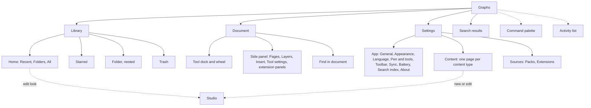

# System map

The whole of Grapho as one system. Every component, flow and screen must fit this map. A design
that contradicts it needs an entry in [Design decisions](DECISIONS.md) and an update here.

> Where this map and [The original UI is the design](DECISIONS.md#the-original-ui-is-the-design)
> disagree, the decision wins: no library sidebar, no tool dock, no permanent side panel over the
> page, original themes and selection look. The original UI in `design/src` is the reference.

Detail lives in `system/`: `ownership.md` (what the core and each shell own), `registries.md`
(commands, settings, content types, deep links), `document.md` (the writing surface and tools) and
`accessibility.md`. The content system is in `content-system/`.

Terms:
- A **document** is anything the user writes in: a notebook, a canvas or an imported PDF.
- A **look** is a cover, folder style or canvas preset.
- **Content** is anything a pack can hold: pens, colour sets, covers, folder styles, canvas presets,
  stickers, templates and themes.
- A **place** is a full view the user navigates to: Library places, a document, Studio, Settings,
  Search results.

## 1. Window sizes

Layout follows the window's width in density-independent units, never the device. It changes
live on resize and keeps state.

| Class | Width | Typical case | Library | Document |
|---|---|---|---|---|
| Compact | under 600 | half of a split screen, small desktop window | top bar, sidebar as drawer, 2 to 3 columns | core note bar, side panel as a bottom panel |
| Medium | 600 to 839 | tablet portrait, half a large desktop | top bar, sidebar as drawer, 3 to 5 columns | full note bar, side panel over the page edge |
| Expanded | 840 and up | tablet landscape, desktop | persistent sidebar, grid fills width | full note bar, side panel beside the page |

The minimum supported window is 360 by 480. A window under 500 tall is also **short**: the tool
dock turns horizontal, the library sidebar is a drawer, and the side panel overlays the page edge
instead of taking width.

## 2. Information architecture

### Navigation model

- **Global**, reachable from every place:
  - Search
  - Settings
  - the command palette (overlay)
  - the activity list (overlay)
- **Library places**:
  - What they are: Home, Starred, Folders (nested to any depth) and Trash.
  - Where they live: on expanded windows, a persistent sidebar at the start edge. On medium and
    compact windows, the sidebar is a drawer opened from the top bar.
  - Deep folders: the sidebar indents four levels, and deeper folders show a path.
- **Per document**: the note bar, the tool dock and wheel, the side panel and the document menu.
  Leaving a document returns to the place it came from, at the same scroll position and selection.
- **Studio**:
  - What it is: a full-screen editor for one look.
  - Opened from: the item it edits, or from a Content page.
  - Done saves. Cancel and Back discard, and ask once if anything changed.
  - Opened from a Sheet (Edit look inside New notebook): the Sheet keeps its draft. Studio replaces
    the place, and Done returns and reopens the Sheet with the new look applied.
- **Settings**: a place, never a modal. On expanded windows it shows its sections in a sidebar.
  A Settings page may push child pages (the theme editor, an extension's page), with Back.
- **Deep links**:
  - Every place, setting, content page, pack and extension has an address, resolved by the core
    (grammar in `system/registries.md`).
  - A missing target falls back to the nearest parent place, with a toast.
  - Commands cannot be linked from outside the app.

## 3. Surface inventory

One job per surface type. A new need fits one of these or gets a decision entry.

| Surface | Its one job | Modal | Placement | Dismiss |
|---|---|---|---|---|
| Top bar | Name the current place and hold its main actions | no | top of a library place, Settings, Search | none |
| Sidebar | Move between library places. Its foot holds Settings and the sync status | no; on small windows, a drawer | start edge | drawer: scrim tap, Escape, Back |
| Note bar | Document chrome: back, title, page indicator, pinned items, More. When receded, a small handle stays to call it back | no | top; floating (default) or full line | recedes while writing, returns on a finger or mouse tap at the top edge, a pen hover there for 500 ms, the handle, focus, `bar.show`, or 1.5 s without pen contact (a pen tap at the top edge always inks) |
| Tool dock | Current tool, quick slots, Undo and Redo, always present | no | edge away from the writing hand | never recedes |
| Tool wheel | Pick and adjust the tool, pen and colour; its centre holds the pens; width and opacity are edited in the pen's segment; Previous tool is `tool.previous` | no | at the pen tip or the dock | lift, tap outside, Escape |
| Side panel | Work beside the content without hiding it: Pages, Layers, Insert, Tool settings, extension panels | no | beside the page (expanded), over the page edge (medium), bottom panel (compact) | close, tab toggle; Escape closes it on compact and returns focus to the page on medium and expanded |
| Popover | A small choice tied to its anchor that applies at once, or a one-time first-use hint with Got it (size, a quick colour, a filter, a tag or folder checklist with Filter, the activity list). Anything that needs Done or Cancel is a Sheet | light | anchored | tap outside, Escape |
| Menu | Commands for its trigger or target; context menus are Menus opened by long press or right click | light | anchored or at the pointer | select, tap outside, Escape |
| Sheet | A task that needs focus and room: create, pick a look, review an import or install, build a pack, move to a folder | yes | bottom on compact, centred large otherwise | Cancel; scrim tap only if nothing changed; Escape |
| Dialog | A short decision that must be answered: irreversible confirm, unsaved changes. At most one field and no lists | yes | centred, small | its buttons; Escape is Cancel |
| Toast | Report what just happened, with at most one action (Undo, View) | no | bottom, on the side away from the writing hand | timeout, swipe, Escape when focused |
| Progress item | A long operation running, with progress and Cancel | no | toast stack, then the activity list | finishes, Cancel |
| Banner | A lasting state of the surface it sits on (offline, safe mode, theme adjusted, sync conflict) | no | inline at the top of that surface, in the flow | resolves; or dismiss when the state is informational |
| Tooltip | Name and shortcut of an icon-only control | no | anchored | pointer or focus leaves |
| Find bar | Search inside the current document | no | docked under the note bar | Escape, close |
| Canvas overlay | Position and navigation over the page: page chip, zoom chip, snapped chip, scrubber, minimap | no | page chip and zoom chip top centre, transient; scrubber and minimap on the off-hand edge | fades after 1.5 s without use |
| Command palette | Find and run any command by name | light | top centre | run, Escape |
| Picker | Choose or manage content (section 5) | host's | wheel, side panel, sheet or Settings page | host's |
| Studio | Edit one look with a live preview | full screen | replaces the place | Done, Cancel, Back |
| Selection bar | Act on the current selection | no | library: bottom floating; canvas: rides the selection; Pages tab and pickers in manage mode: bottom of their host | clear selection, Escape |
| Settings page | Home of a group of preferences | no | the Settings place | Back |

"Light" means no scrim. A finger or mouse tap outside dismisses it and is not passed through to
what is below. A pen-down on the page outside closes it and the stroke is drawn, so ink is never
lost to chrome.

Consolidation rules:

- The Side panel holds the work that Inspector, Panel and WheelPanel once held. The New item Sheet
  covers quick creation. There is no centred modal over the page for colour or customise (principle 1).
- Context menu, OverflowMenu, FolderMenu, NewMenu, SortMenu and SelectionMenu are one Menu with
  different command lists.
- Sheet or Dialog: anything with a list, grid or steps is a Sheet. That includes install consent.

### Stacking and dismiss order

- At most one modal layer: a Sheet or a Dialog. A Sheet may also have one Dialog above it, for its
  own confirm.
- A Sheet never opens another Sheet. When a Sheet needs a second picker, or Get more, it pushes a
  view inside itself, with Back.
- "More in Settings" inside a Sheet works in three steps:
  1. Ask to keep or discard any changes.
  2. Close the Sheet.
  3. Navigate to Settings.
- Popovers and Menus close when anything else opens. A Menu item that opens a Sheet closes the
  Menu first.
- Z order, from bottom to top:
  1. Canvas
  2. Chrome (top bar, note bar, dock)
  3. Side panel
  4. Sheet
  5. Dialog
  6. Popover and menu
  7. Toast
  8. Drag ghost

  Popovers and menus sit above every modal layer, because they open from inside a sheet or a
  dialog as well as from chrome. Since they close whenever anything else opens, only one is ever
  visible. Toasts that arrive while a Dialog is open wait until it closes.
- Sheets and the Side panel push views up to three levels below their root; a Popover pushes one.
  Every pushed view has Back.
- Back and Escape close the topmost item first, in this order:
  1. Popover or menu (its pushed view first)
  2. Dialog
  3. A view pushed inside a sheet
  4. Sheet
  5. A view pushed inside the side panel
  6. Bottom panel on compact
  7. Selection mode
  8. The place itself

  In the command palette, Escape first clears a typed query, then closes it.

## 4. Cross-cutting systems

Each system has one owner pattern. No surface reimplements it. What the Rust core owns and what
each shell owns is in `system/ownership.md`.

### 4.1 Commands and shortcuts

The **command registry** (data in the core) owns every action. Each entry has:
- id, label key, icon and group
- a fixed priority, which decides the order things overflow in (never usage frequency)
- contexts
- an enabled predicate, from a fixed vocabulary
- an invocation mode: once, toggle or while held
- shortcuts per platform

Menus, the note bar, the dock, the Selection bar, the palette, shortcuts, tooltips and extensions
all read from it.

- Shortcuts resolve by the focused context:
  - Ctrl+F is find in the document inside a document, and global search in the library.
  - Ctrl+Z undoes the document stack inside a document, and the library journal in the library.
  - A toast's Undo always undoes its own action.
- Extension commands cannot take a built-in shortcut. If one clashes, the extension's command is
  left unbound, and its page says so.
- The palette opens with Ctrl+K, or Cmd+K on Apple.
- Tooltips show the command's name and shortcut.
- Hardware and gesture inputs map to commands, never to hard-wired behaviour. Defaults:
  - Holding the S Pen button is the eraser while held.
  - A click of the S Pen button summons the wheel at the pen tip.
  - Two-finger tap is Undo, and three-finger tap is Redo, only in pen-only mode.

### 4.2 Undo, delete and confirm

1. **Reversible in a document**: the document's undo stack. Undo and Redo sit in the tool dock,
   which never recedes.
2. **Reversible in the library**: done at once, journaled, then a toast with Undo. This covers
   delete, move, rename, tag and removing a pack. Star and turning a pack on or off are
   journaled but show no toast, because their own switch undoes them in place.
   - Delete moves the item to Trash for 30 days.
   - The library journal keeps the last 100 actions per device, so Undo still works after the toast
     has gone.
3. **Irreversible**: a Dialog that names what will be lost, with a danger button labelled with the
   verb and count ("Delete 12 forever"). This covers empty Trash, delete forever, and erasing an
   extension's stored data. There is no hold-to-confirm.

Restore from Trash returns an item to its original folder, or to Home if that folder is gone.

Extensions follow the same rule as packs: removal is immediate with Undo and goes to Trash, and
only erasing an extension's stored data is a Dialog.

Removing a pack that has items in use first shows the remove Sheet, so the user sees what keeps
working. A pack with nothing in use is removed at once, with the toast.

### 4.3 Notifications

- **Toast**: at most two visible.
  - A new toast removes the oldest one that has no Undo.
  - If both visible toasts have Undo, the older one moves to the activity list, with its Undo still
    working.
- **Progress item**: shown for any core job that is still running 1000 ms after it starts.
  - It shows progress and Cancel, and ends as a toast with the result.
  - The activity list holds running and recent jobs.
- **Banner**: a lasting state, inline on the surface it describes. Never a floating corner notice.
- **Dot**: only for "updates available" on the Packs and Extensions entries, after a background
  check. No other badges.

### 4.4 Search

One SearchField component, three scopes:

| Scope | Entry | Searches | Results |
|---|---|---|---|
| Global | top bar search, Ctrl+F in the library | titles, handwriting, PDF text, tags, folder names | Search results place: grouped by document, with a snippet, and filters for type, date, folder, starred and tag. Opening a result goes to the page of the match |
| In document | note bar More, Ctrl+F in a document | handwriting and PDF text in this document | find bar with match count, next and previous |
| Filter | the field at the top of any picker, list or settings index | the items in that list | the list narrows in place |

The core owns the index and its queries. Handwriting recognition is a per-platform provider
behind one seam.

### 4.5 Settings

The **settings registry** (data in the core) defines every preference. Each entry has:
- id, type and default
- a scope: app, device, document or tool
- whether it syncs
- one home section
- its control
- the contextual surfaces where it also appears

A contextual appearance is the same setting with the same value. It shows "More in Settings",
which deep-links to the setting's home.

Sections:

- **App**: General (includes Keyboard), Appearance (theme, density), Language, Pen and tools
  (includes handedness and pen-only), Toolbar, Sync, Battery, Search index, About. Text size
  follows the operating system's scaling.
- **Content**: one page per content type, from the content type registry. Themes links to
  Appearance.
- **Sources**: Packs, Extensions.

### 4.6 States

| State | Rule |
|---|---|
| Loading | skeletons in the real layout only after 300 ms, and once shown they stay for at least 300 ms |
| Empty, first use | one sentence and one primary action; the mascot is allowed |
| Empty, filtered or searched | say what is filtered, offer Clear, no mascot |
| Error | inline, say what went wrong and what to do, with Retry; never looks like empty |
| Partial | the items that worked show, and a Banner names how many failed, with View |
| Offline | only the pack catalogue, sync and extension network access have an offline state |
| Sync | off, up to date, syncing, offline (queued), conflict (both versions kept, Banner with Compare), storage full (Banner with what to do) |
| Very large | lists virtualize above 200 items and stay responsive at 10,000; counts appear in controls |

### 4.7 Selection

One grammar for every collection (library, pickers in manage mode, Content pages):

- Tap or click opens or applies.
- Entering selection mode:
  - Touch: long press, then lift.
  - Any input: the Select command.
  - Mouse: Ctrl or Cmd click. Shift click selects a range.
- In selection mode:
  - A tap toggles an item.
  - On a keyboard, Space toggles and the arrow keys move.
  - Select all and range selection work on ids in the model, not on the rows on screen.
- The Selection bar shows the count, up to four actions, and More.
- The selection look is the tinted fill plus a check.

Canvas selection is the lasso, with its own floating Selection bar. It shares the bar component
and the commands, not the gestures.

### 4.7.1 What long press does

Long press has one meaning per kind of target:

| Target | Long press, then lift | Long press, then move |
|---|---|---|
| Item in a collection (tile, row) | enter selection mode with it selected | drag it (and select it) |
| Quick slot | the slot's Menu (pin, unpin, replace) | reorder the slot |
| Icon-only control without its own long press | its Tooltip | nothing |
| Page (canvas) | nothing; the pen and lasso own the page | nothing |

An item's Menu is always reachable without long press: the ••• button on the tile (always
visible on touch, on hover with a mouse), right click, and the Menu key.

A picker in pick mode is a choice list, not a collection: its tiles have no Menu and no •••.
Long press then lift there enters manage mode with that item selected, where the actions live.

### 4.8 Drag and drop

- How a drag starts:
  - Touch: long press, then move. This also selects the item.
  - Mouse: after 4 px of movement.
- Library: drop items onto a folder, in the grid or the sidebar. Lists that have an order reorder
  by drag.
- Document:
  - Drag stickers, images and templates from the Insert tab onto the page.
  - Reorder pages in the Pages tab by drag.
  - Drop files from outside the app to import them.
- Every drop:
  - has a menu and keyboard equivalent ("Move to", "Insert")
  - can be undone
  - highlights its target on enter
- Moving a folder into itself or one of its own folders is not allowed, and the reason is shown.

### 4.9 Import, export and share

These are commands, so their entry points are the same everywhere:
- **Import**: the library New menu, drop-in and the platform share target.
- **Export** and **Share**: the document menu, the item menu and the Selection bar.

Share is Export to a chosen format, handed to the platform share sheet. Long exports are jobs.

### 4.10 First run

The first-run Sheet is the one Sheet whose scrim tap does nothing; Skip and Escape keep the
defaults.

1. Language, asked only if the device language is not supported.
2. Writing hand and pen-only.
3. The empty library, with New notebook as the primary action, Import beside it, and a quiet
   "Sign in to restore" link where sync is available.

Permissions are asked in context: files at import, the camera at Take photo.

## 5. The unified picker and manager

One pattern for every content type, now and later.

### Anatomy

1. **Header**: the content type's name, a Filter field, Sort (Recently used, Name, Newest), and a
   grid or list view where the type allows both.
2. **Source filter**: All, Built in, Yours, then each contributing pack and content source, with
   counts, then Hidden.
   - It is measured: chips while they fit, at most six sources, otherwise its dropdown.
   - Hidden lists hidden items, each with Unhide.
3. **Items**: drawn by the type's renderer kind, at its preview size. Virtualized.
4. **Footer slots**, always in this order:
   - **Get more**: the pack catalogue, filtered to this type.
   - **Import**: a `.graphopack` file, or another format the type accepts.
   - **New**: where the type is editable.
   - **Manage**: in pick mode only.

   In narrow hosts, the footer is measured in three steps: labels, then icon buttons, then one More button.

### Modes

- **Pick**: choose one item for a target. A tap applies it, and the host decides whether to close.
- **Manage**: the selection grammar from 4.7.
  - Actions: Edit, Duplicate, Rename, Hide (for built-in and pack items) or Delete (for your own),
    and Export as pack.
  - Manage packs opens Settings, Packs.

### Placements

| Host | Used for |
|---|---|
| Tool wheel | compact pick of pens and the current colour set; More opens the side panel picker |
| Side panel | in a document: Insert (stickers, images, templates), pens, colour sets |
| Sheet | creating and editing: a cover for New notebook, a folder style, a canvas preset |
| Settings page | Content, one page per type, opened in manage mode |

One home per job:
- Pens are picked in the wheel, edited in the Tool settings tab, and managed in Content, Pens.
- Themes are picked and managed in Appearance.

### Content type registry

Each type is a data entry in the core:
- id and label keys
- renderer kind, from a fixed set: swatch, image tile, cover, pen sample, page thumbnail, theme
  preview
- preview size
- editor kind
- what it applies to
- sort keys
- whether it can be packed
- its placeholder

A new type that uses an existing renderer kind needs no shell code and no new screens.

## 6. Content system (summary)

Detailed in `content-system/`.

- **Packs** hold content only. **Extensions** add behaviour. One subsystem installs, enables,
  updates and removes both.
  - Contextual entries: Get more and Import in every picker.
  - Management: Settings, Packs and Settings, Extensions.
- **Documents never depend on packs.** A document embeds a copy of every pack asset it uses,
  keyed by content hash. It renders on any device, offline, with or without the pack.
- **Library usages are retained.** Wheel slots, quick slots, saved looks, the active theme and
  folder styles in use keep working:
  - Turn a pack off: they stay where they are, and the pack leaves the pickers.
  - Remove a pack: each item still in use is kept as a user copy marked with its origin. The pack
    itself goes to Trash.
- **Extensions**:
  - They run as scripts in a sandboxed interpreter owned by the core, with no DOM and no native
    code. This replaces the earlier "sandboxed web code" model for extensions.
  - Their UI is declarative, built from Grapho's standard controls, and each shell renders it
    natively.
  - Their permissions are checked at the interpreter's boundary.
  - A block whose extension is missing shows its stored fallback in a placeholder that names the
    extension.

## 7. Extension slot map

Everything an extension adds carries its name in tooltips and menus. Each extension's page in
Settings lists every place it adds to, with Turn off.

| Slot | Where | Looks like | Growth and overflow |
|---|---|---|---|
| Command | palette, shortcuts, menus that accept extension commands | a normal command, grouped under the extension's name | palette: unlimited. Menus: an Extensions group of at most five; the rest in "More from extensions" |
| Note bar item | note bar, among the pinned items | an icon button the same size as its siblings | the user pins at most two extension items, within the four pinned items; the rest go in More |
| Side panel | the side panel's tab rail, after the built-in tabs | a tab with the extension's icon | the rail shows six tabs; more go in the rail's overflow menu |
| Canvas tool | the wheel's tools ring and quick slots | a tool segment, like a built-in tool | the ring holds eight; more go to the Tool settings tab's Tools list, which the user curates |
| Block type | inside documents | a framed block with the extension's name on focus | when the extension is missing, its fallback shows in a placeholder |
| Selection action | Selection bar More | a menu row in the extension's group | always in More |
| Library item action | item Menu | a menu row in the extension's group | at most three; the rest in a submenu |
| Insert source | Insert tab, source filter | a source | the source filter rule |
| Import or export format | the Import file chooser and the Export sheet | a format option | the list scrolls |
| Settings page | Settings, Extensions, the extension's page | a page of standard controls | one page per extension, never a top-level section |
| Content source | picker source filter | a source, like a pack | the source filter rule |

Extensions cannot:
- add places
- change the Library layout
- show banners outside their own panel
- draw over the page outside a block or their panel
- trigger commands that need a permission they were not given

## 8. Growth rules

Counts in the "Now" column are measured from the current design, or marked as estimates (~).

| Surface | Now | At 2x | At 5x |
|---|---|---|---|
| Top bar actions | 4 | four on the right; the rest in overflow, in priority order | same |
| Note bar pinned items | ~3 | at most four, two of them extension items; the rest in More | same |
| Quick slots | new | five: pinned first (never dropped), then recent | same |
| Wheel pens | 6 | ring pages, with page dots | the wheel's Pens page, with Filter |
| Colours per set | 8 to 12 | two rings | at most 24 per set; more colours become another set |
| Colour sets | 2 to 3 | set switcher list | set switcher with Filter |
| Sidebar folders | ~6 | scrolls | tree with collapse; Filter above 30 |
| Library items | ~tens | virtualized | virtualized; an alphabet rail when sorted by Name |
| Picker items | 9 to 40 | virtualized grid | grid with Filter and the source filter |
| Picker sources | 2 to 4 | chips | dropdown above six |
| Side panel tabs | 4 | rail | rail with overflow above six |
| Settings sections | 12 | grouped as App, Content, Sources | Filter on the index; extension pages only under Extensions |
| Content types | 8 | Content page groups | Content becomes a list with Filter |
| Tabs in a sheet | 3 to 4 | at most five | above five, a list on the start side replaces the tabs |
| Selection bar | 4 and More | same | same |
| Menus | up to 10 rows | groups with headings | groups, a submenu for extensions, and the palette |
| Toasts | 1 | two visible | two visible; the rest in the activity list |
| Packs, extensions | a few | list with Filter and Sort | grouped by source, Filter |

## 9. Platform notes

The structure is the same everywhere. These differences are intended:

- **Android**: system Back follows the dismiss order in section 3. Predictive back is supported.
- **Windows**: the top bar sits in the window title bar. Menus, the palette and shortcuts are
  primary. Hover reveals the selection affordance.
- **macOS**: the app menu bar lists the registry's commands by group. The toolbar is the top bar.
- **iPad**: Apple Pencil double tap and squeeze map to commands, like the S Pen button.
- **Every platform**: the same command, setting and content type ids, and the same vocabulary.
