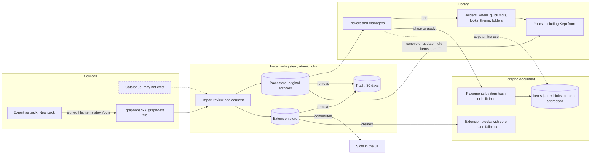

# Content system

How Grapho gets new pens, covers, stickers, themes and behaviour without breaking a note. This
folder is the spec for packs, extensions, the library they feed, and the way a document carries what
it uses. It is the detailed version of SYSTEM-MAP section 6.

## The model in plain language

1. **A pack is content.** Pens, colour sets, covers, folder styles, canvas presets, stickers,
   templates and themes, in any mix, in one `.graphopack`. A pack cannot contain code.
2. **An extension is behaviour.** Scripts (standard JavaScript, ES2020 subset) in a sandboxed engine
   owned by the core, with no DOM and no native code, in a `.graphoext`. Their UI is a declarative
   tree of Grapho's standard controls that each shell draws natively. Permissions are checked at the
   API boundary.
3. **One subsystem** installs, turns on, turns off, updates and removes both. The user sees "pack"
   and "extension", never a mix.
4. **Everything has an identity and a signature.** A pack or extension has a UUID, a name, an author
   and a publisher key. The key is pinned to the id on first install. An update signed by another key
   is not an update. Unsigned files are refused.
5. **A document is self-contained.** It embeds the resolved item (definition and bytes) of everything
   it uses from a pack, from Yours or from an extension, keyed by content hash. Built-in content is
   referenced by built-in id. No pack or extension action edits a document.
6. **The library keeps working.** Holders (wheel slots, quick slots, saved looks, defaults, the active
   theme, folder styles) survive Off and Remove. Remove keeps each used item as a user copy "Kept from
   Botanica". Items that are Yours are never touched by a pack action.
7. **Remove is reversible.** A removed pack waits in Trash for 30 days. Remove and update are atomic
   core jobs, resumable after a crash. A pack keeps its previous version for 30 days.
8. **Extension content never vanishes.** A block stores its data and a fallback picture and text made
   by the core. Without the extension the note shows the fallback in a labelled frame.
9. **Trust is visible and bounded.** Consent shows every permission, including those a slot implies,
   and one sentence naming what can be read and where it can go. Three strikes turn an extension off.
   Safe mode starts with themes, packs and extensions off.
10. **Sync is in scope.** Records, on and off and order sync; archives download when online; documents
    never wait.
11. **New types are data.** A registry entry; a new renderer kind needs shell code; no new screens.

## Diagram

Dotted arrows are optional or one-time: the catalogue may not exist, and a pack is read for a document
only when an item is first used.

## Files in this folder

| File | What it holds |
|---|---|
| `manifests.md` | Pack and extension manifests, permission vocabulary, archive rules, containers, signature file, on-device store |
| `documents.md` | Embedded items, validators, versions, compaction and merge (goes into `docs/file-format.md`) |
| `registry.md` | Content type registry, the eight types, slot rules, what "no new screens" means |
| `extension-api.md` | Language, capability objects, UI schema, block contract, events, quotas, errors, slot to permission matrix |
| `trust.md` | Signing, consent, blocklist, containment, crash handling |
| `lifecycle.md` | States, atomic jobs, storage, the two retention rules, action tables, import conflicts |
| `sync.md` | What syncs and how conflicts resolve |
| `flows.md` | Every flow step by step |
| `surfaces.md` | Wireframes and the route table for every picker host |
| `stress-tests.md` | Hard cases and the remaining gaps |

Dependencies: SYSTEM-MAP sections 3 to 7; `design/themes/custom-themes.md` is the single source for
theme data, the contrast guard, derivation and the way back; `docs/file-format.md` takes `documents.md`.

## Decisions

- **Self-contained packs.** An item references only the same pack. The exporter copies parts used
  from other packs (`components`, written by the editors) as resources with their own licence.
- **Resources.** Role item or resource; a font or texture is a resource with no tile.
- **Document store.** `items.json` and `blobs/`, both content addressed; version 4 only when the
  note holds a non-built-in item.
- **Provenance is not identity.** `origins` are outside the item hash and merge by union.
- **Newer schema is retained.** A pack from a newer schema keeps its original archive; "Finish
  installing" after an app update.
- **Version format** is three integers up to 65535.
- **Extensions go to Trash** with stored data; deleting data is a separate Dialog.
- **Built in cannot be removed.** The last visible item of a type with a default cannot be hidden.
- **Three consent tiers** plus detail-only `storage.own`; the sentence is generic.
- **One document may hold two versions of a pack**, by hash.
- **Limits**: 250 MB pack, 5000 items, 20 MB asset; 5 MB extension; document store 500 MB.
- **Two retention rules** (documents embed, library keeps holders), stated in `lifecycle.md`.
- **Hidden** is the last source filter entry; an item Menu has Hide.
- **Item belongs to one source.** Export copies into a file only; import links hash matches.
- **Made by you** records live in Packs; they are not sources and have no switch.
- **Trust on first use** of the publisher key; keys of user packs live in the keystore.
- **Keep or Use new** per held item on update, default by type.
- **No toast for the switch.** The switch is its own undo.
- **Remove Sheet only when something uses the pack.** Otherwise remove at once with Undo.
- **Strikes.** Three in a session turn an extension off.

## Open questions

- Apple App Store policy on interpreted extensions (`extension-api.md`, section 10 sets the rule until answered).
- Whether an online catalogue exists. The spec works without one.
- Whether `all-rights-reserved` assets carry `noExtract` (render only; applied here, see `documents.md`).
- Licence text travelling inside a note (stress-tests, Gap 3).
