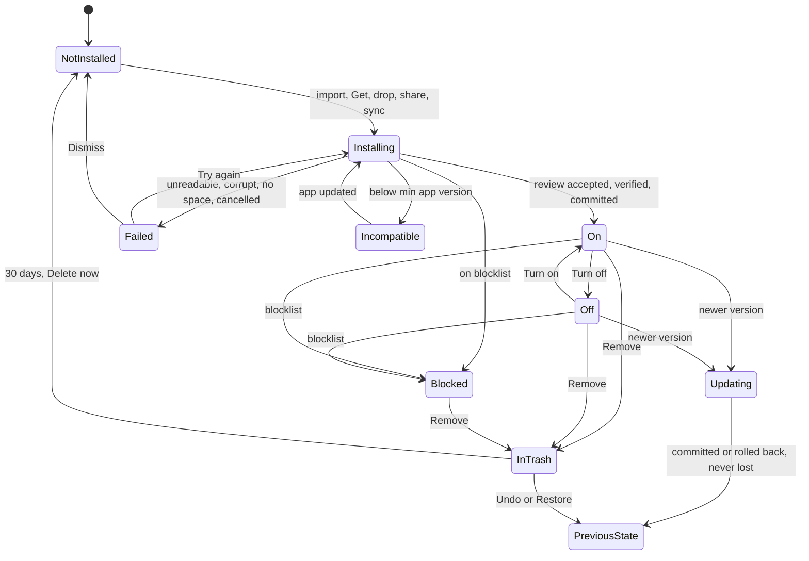

# Lifecycle

One state machine serves packs and extensions. The user never sees state names; the right column says
what they see.

## Pack states

`PreviousState` means On or Off, whichever it was. Update available is a marker on On or Off, set
when a newer file arrives or, if a catalogue exists, when it lists one. Waiting to download (sync) is
a marker on a record whose archive has not arrived.

| State | What the user sees | Can do |
|---|---|---|
| Not installed | Nothing, or a catalogue row with Get | Get, Import |
| Installing | Progress item "Installing Botanica" with Cancel; the row greyed with a ring | Cancel |
| On | Switch on; items in pickers under the pack | Off, Export, Remove, open |
| Off | Switch off, quiet row; items out of pickers and Get more lists (the pack is listed as "Installed, turn on") | On, Export, Remove |
| Update available | A dot on the Packs entry, only when a catalogue exists or a newer file was just imported; the row line "Update to 1.3.0" | Update, Skip this version |
| Updating | Progress item; the old version works until the swap | Cancel |
| In Trash | In the Trash place under a Packs filter; "removes in 12 days" | Restore, Delete now |
| Failed | A line in the row with the reason and Try again; the previous state untouched | Try again, Dismiss |
| Incompatible | "Needs Grapho 1.5 or newer", no install button | Update the app |
| Blocked | "Grapho stopped this pack. Reason." Off, cannot be turned on | Remove |
| Partial (marker) | Detail note "Some content is not supported in this version" with the list. A pack whose items are all unknown types is Incompatible | Finish installing after an app update |
| Waiting to download | Row "Waiting to download" | none |

## Extension states

The same diagram with these changes.

- **Needs permission** sits between Installing and On, and between Off and On whenever a permission is
  not granted. It is entered from "Install turned off" followed by Turn on, and by a staged update.
  The row reads "Needs your OK for 2 permissions" with Review. Review opens the consent Sheet.
- **Updating with more permissions** keeps the old version running. The new version waits; the row
  reads "Update waiting for your OK" with Review. Update later leaves it so; Cancel discards it.
- **Turned off after problems** is entered at the third strike in a session (`extension-api.md`) and
  by a crash attributed in start-up safe mode. Data is kept. Turn on again clears the strikes.
- **Incompatible** includes an unknown permission id, an unknown runtime, a schema too new, a minimum
  app version above the current, or a shell with no runtime.
- Removal goes to Trash with stored data (30 days). Delete now asks the case 3 Dialog "Delete
  Flashcards and the 12 decks it saved? This cannot be undone."

## Atomic jobs and recovery

Install, update, remove and restore are core jobs, not UI actions. Each is a journalled transaction:
1. Take the install lock for (kind, id, publisher). A second request for the same triple queues and
   is re-evaluated against the result ("Already installed") when it reaches the front.
2. Check free space for 3 times the pack size (original, new, staging); refuse before starting.
3. Stage (verify, sanitise, write to a staging area); write the journal.
4. Commit in one database transaction: for Remove, first create kept copies and retarget every holder
   in the core reference table, then mark the record Trashed; for Update, retarget pinned holders per
   the rules below, then swap the version.
5. Delete staging.

All or nothing: a failure before step 4 changes nothing; after a crash, startup replays or discards
the journal, so a job resumes or rolls back and never leaves a half state. A startup repair also
scans the reference table for dangling holders (a holder whose item is missing) and replaces them by a
placeholder holder plus a line in the activity list. Every library feature that keeps a reference to
a content item must register a holder through the core reference table; a feature that does not is a
defect found by the repair, not a silent loss.

## Storage

- One copy of each pack: the original archive. Assets are read from it. Thumbnails are an evictable cache.
- Trash is a flag. The previous version after an update is kept 30 days with "Revert to 1.2.0" on the
  detail; for an extension, its storage is snapshotted for the same period.
- The Packs page shows the total and per pack size. A pack above 250 MB is refused; there is no total
  cap, but install is refused with "Not enough space" when the 3 times rule fails.
- Trash expiry counts days the app was opened (a monotonic count plus the clock), is a floor, and a
  first launch after a gap longer than 30 days shows one notice before purging: "3 removed packs will be
  deleted. Restore any you want to keep."
- The usage index (per note: item hashes and origins; per pack: counts by holder kind) is rebuilt in
  the background; counts say "At least 3 notes" until it finishes.

## What each state means for content

| Subject | Installing | On | Off | In Trash | Failed, Incompatible, Blocked |
|---|---|---|---|---|---|
| Items in pickers | no | yes | no | no | no |
| Library holders | n/a | live | stay as they are | became user items or linked items | stay (Blocked: draw the placeholder, theme to Ink) |
| Documents | n/a | embedded copy | embedded copy | embedded copy | embedded copy (Blocked hash: placeholder) |
| Extension contributions | no | yes | no | no | no |
| Extension blocks | n/a | live | fallback frame | fallback frame | fallback frame |

## Two retention rules

**Rule A (documents).** A document always embeds the resolved item (definition and bytes) of every pack,
user or extension item it uses and never depends on a pack. Built-in content is referenced by built-in
id. No pack or extension action touches a document, except the explicit per-document "Use the newer
versions", which replaces only the items the user ticked.

**Rule B (library).** Library holders (wheel slots, quick slots, saved looks, defaults for new
notebooks, the active theme, folder styles, colour sets in the editor) are the only things retained as
user copies on Remove, or when an update drops an item. Nothing else is copied. Items that are Yours
are never affected by any pack action. The list of holders per type is in `registry.md`; Remove
enumerates the core reference table generically.

## Pack actions by where an item is used

Columns: **Unused** (only in the pack), **Document**, **Holder** (any library holder), **Active
theme**, **Folder style**, **Yours or linked** (an item that is Yours, or an item on import linked to a
Yours item by hash).

| Action | Unused | Document | Holder | Active theme | Folder style | Yours or linked |
|---|---|---|---|---|---|---|
| Turn off | Leaves pickers and Get more | No change | Stays and works | Stays active | Stays | Stays in Yours |
| Turn on | Returns | No change | No change | No change | No change | No change |
| Remove (to Trash) | Goes to Trash with the pack | No change | A kept copy in Yours, "Kept from Botanica"; the holder is retargeted in the same transaction | A kept theme in Yours, still active | A kept style in Yours | Unaffected, stays in Yours |
| Undo or Restore | Returns | No change | Pack returns; kept copies stay and are not merged back | Same | Same | Unaffected |
| Trash expires, Delete now | Gone | No change | Kept copies stay | Stays | Stays | Unaffected |
| Update, item unchanged | Same | No change | Same | Same | Same | Same |
| Update, item changed (same id, new hash) | New version in pickers | Keeps the embedded copy | Holders are pinned by hash. The update review says "3 items in your wheel changed" with **Keep mine** (default for pens, tools, colour sets: a kept copy of the old one) or **Use new** (default for stickers, covers, templates) | Re-checked by the guard; follows `custom-themes.md` | Pinned like holders | Unaffected |
| Update, item renamed (new id, same shipped hash) | Follows | Follows for "Use newer versions" | Holders carry over to the new id | Carry over | Carry over | Unaffected |
| Update, item removed | Gone | Keeps the embedded copy | A kept copy "Kept from Botanica" | Kept theme, stays active | Kept style | Unaffected |
| Update, item added | Appears | n/a | n/a | n/a | n/a | n/a |
| Revert to previous version (30 days) | Previous items | No change | Pinned holders unchanged | Re-checked | Unchanged | Unaffected |
| Replace with older version (import review) | Older items | No change | Holders move per Keep or Use, same as Update | Re-checked | Same | Unaffected |
| Use the newer versions (document menu) | n/a | Replaces the ticked items, one undo step | n/a | n/a | n/a | n/a |
| Hide an item | Hidden from pickers; listed in Hidden | No change | Stays | Not allowed while active | Stays | Stays |

Kept copies get ids derived from (packId, assetId, item hash), so every device makes the same copy.
Label "Kept from Botanica" (name only; the author is added only when two kept names clash).

### Extensions by where used

| Action | Contributions in the UI | Blocks in documents | Its stored data |
|---|---|---|---|
| Turn off | Removed at once, remembered | Fallback frame | Kept |
| Turn off one contribution | That one removed | n/a | Kept |
| Remove (to Trash) | Removed | Fallback frame | Kept 30 days |
| Restore | Back in its old state | Live again | Intact |
| Delete now, expiry | Gone | Fallback forever | Delete now asks the Dialog; expiry deletes |
| Update, same permissions | List refreshed; a dropped contribution disappears | Live; a dropped block type becomes a fallback frame | Snapshotted, migrated on a staged copy |
| Update, more permissions | Old version keeps running until consent | Live | Unchanged |
| Revert to previous version | Back | Back | Snapshot restored |
| Revoke a permission | Features needing it turn off with a reason | Live unless it needs it | Kept |

## Conflicts at import

Evaluated at the install lock, by (kind, id, publisher), then by name.

| Situation | Status in review | Buttons |
|---|---|---|
| New id | New | Install, Cancel |
| Same id, same version, same publisher | Already installed | Open, Cancel |
| Same id, same publisher, higher version | Update from 1.2.0 | Update, Cancel |
| Same id, same publisher, lower version | Older than installed 1.3.0 | Cancel, and secondary Replace with older version (verbs reversed in the changes list: Removed becomes Added) |
| Same id, same version, same publisher, different bytes | Different from installed | Replace, Cancel |
| Same id, different publisher | Not an update: "From a different publisher than your Botanica" | Install as a separate pack, Cancel |
| Same id, in Trash | "You removed this on 24 Oct" | Restore (primary; it updates if the file is higher), Cancel |
| Different id, same name | New, with "Same name as one you have, by Ana Ruiz" | Install, Cancel |
| Newer schema | Known types import | Install the rest, Cancel; unknown listed |
| Below min app version | Incompatible | Close |
| No signature | Refused unless the device's own export | Close |
| A hash match with an item already in Yours or another source | The item is linked: shown once under its first source | none, informational: "3 items you already have" |
