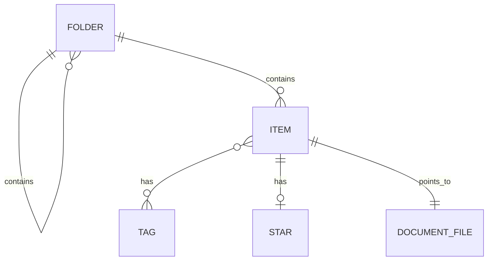
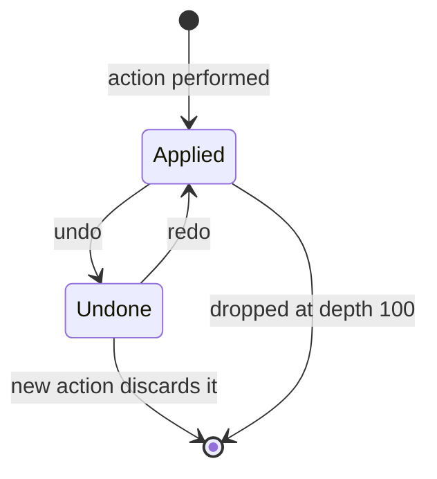
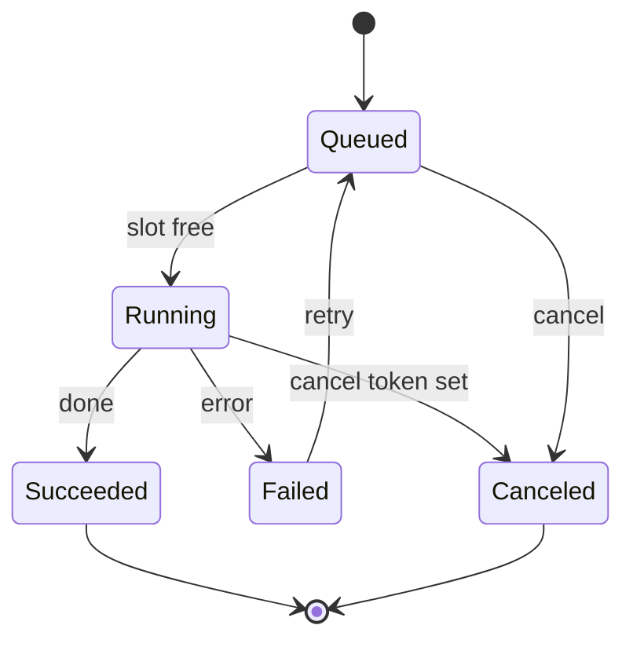

# Ownership: core, shells, library, journal, jobs, search, extensions

Detail spec for ownership. It says who owns what, and the shape of the data the core owns. Anything
that changes `standards/01-architecture.md` or `docs/file-format.md` is marked **Proposed change**.

## 1. What the core owns and what a shell owns

The rule: the core owns data and logic that must behave the same on every platform. A shell owns
rendering, input, platform services and the renderers for registry data.

| Area | Core owns | Shell owns |
|---|---|---|
| Library | folders, items, stars, tags, trash, queries, sort, filter | rendering lists and grids, drag gestures, drawer |
| Library journal | entries, depth, persistence, undo and redo | the Undo command, the toast, the activity list view |
| Document | strokes, pages, layers, document undo stacks, geometry | pen input capture, canvas surface, palm rejection hardware signals |
| Registries | commands, settings, content types as shipped data with string keys | renderers: menus, palette, shortcut capture, settings controls, pickers |
| Settings store | values, defaults, scope, sync flag | the control for each setting kind |
| Jobs | id, state, progress, cancel token, result, error | progress item and activity list rendering |
| Search | index format, PDF text extraction, queries | recognition provider (per platform), results place |
| Deep links | grammar, resolver to a place descriptor | navigating to the descriptor |
| Packs and extensions | install state, enabled state, update state, the interpreter | consent Sheet, review Sheet, panel rendering |
| Platform services | nothing | files, share sheet, camera, permissions, notifications, clipboard, haptics |

Rules that follow:

1. The core never calls a platform API. A shell asks the core, the core answers with data or a
   descriptor, and the shell renders it.
2. A shell never decides what a command is enabled for, what a setting's default is, or what a deep
   link means. It asks the core.
3. A shell never holds the only copy of user data. Window state, scroll positions and selection are
   shell state, restored by the shell, and are allowed to be lost without data loss.
4. Every core call that can fail returns a result with an error kind. No panic crosses an ffi
   boundary.

**Proposed change** to `standards/01-architecture.md`: add the table above as the ownership
section, and add the library model, journal, job runner, search index, registries, settings store,
deep link resolver and extension runtime to the core module list.

## 2. Library model

Ids are 128 bit random, written as 26 character Crockford base32 strings in the ffi and in deep
links. They never change and are never reused. Timestamps are UTC milliseconds.

### Folder

| Field | Type | Notes |
|---|---|---|
| id | id | |
| parentId | id or null | null means Library top level. Nesting has no depth limit in the model |
| name | text | unique among siblings after trimming; the core appends " 2" on clash |
| styleRef | content ref or null | folder style content type; null uses the default |
| sortOrder | integer | manual order among siblings; gaps of 1024 so a reorder touches one row |
| createdAt, modifiedAt | time | |
| deletedAt | time or null | set on the folder root only; descendants are in trash by inheritance |

A folder cannot be moved into itself or a descendant. The core answers `canMove(folderId, targetId)`
with `ok` or a reason (`into_self`, `into_descendant`, `name_clash_resolved`), and the shell shows
the reason next to the disabled target.

### Item

An item is one document entry in the library (notebook, PDF or canvas).

| Field | Type | Notes |
|---|---|---|
| id | id | the document id used in `grapho://doc/<id>` |
| kind | enum | notebook, pdf, canvas. Append only |
| title | text | |
| folderId | id or null | null means Library top level |
| coverRef | content ref or null | cover content type, or canvas preset |
| pageCount | integer | cached, updated on save |
| createdAt, modifiedAt, openedAt | time | `openedAt` drives Recent |
| starred | bool | a star is a flag on the item, not a separate entity |
| tagIds | id list | |
| deletedAt | time or null | null means live |
| deletedFromFolderId | id or null | set when trashed, used by Restore |
| fileRef | file ref | the `.grapho` file; the library never parses it for listing |

### Tag

`id`, `name` (unique, case folded), `colorRef` (optional token name, never a raw colour),
`createdAt`. Tags cross-cut folders. Both tags and folders are filters, never containers that
own the item exclusively.

### Trash

- Trash is not a folder. It is the query `deletedAt is not null`, shown as the place
  `grapho://library/trash`.
- Deleting a folder sets `deletedAt` on the folder and on every item inside it that is live, all
  with the same timestamp and a shared `deleteBatchId`, so Restore of the folder restores exactly
  those items.
- **Restore** returns an item to `deletedFromFolderId`, or to Library top level if that folder
  is gone or itself still in Trash. Restoring an item whose folder is in Trash offers the choice
  in a Dialog of "Restore folder too" or "Restore to Library".
- **Purge**: a core job (`library.purge`) runs at app start and once a day while the app is
  open. It removes items and folders whose `deletedAt` is older than 30 days. It is silent unless
  it removed something, then it posts one toast.
- **Delete forever** and **Empty Trash** are irreversible, ask in a Dialog that names the count
  ("Delete 12 forever"), are not journaled and cannot be undone.

### Queries

The core exposes list queries that return ids and a cheap summary row: `inFolder`, `recent`,
`starred`, `trash`, `withTag`, `all`, each with sort and a source of change events. Every query
pages (offset and limit) and must stay responsive at 10,000 items. Select all and range select
operate on the ordered id list from the query, never on rendered rows.

## 3. Library action journal

Separate from document undo stacks. Document edits never enter it.

### Entry shape

| Field | Type | Notes |
|---|---|---|
| seq | integer | monotonic per device |
| at | time | |
| action | enum | delete, move, rename, star, tag, pack_toggle, pack_remove. Append only |
| label | label key plus arguments | for the activity list ("Moved 3 items to Maths") |
| targets | id list | items, folders, tags or pack ids |
| before | map | the prior value of each changed field, per target |
| after | map | the value written, per target |
| state | enum | applied, undone |

Undo of an entry writes `before` back; redo writes `after` again. The journal stores field
values, never snapshots of documents, so an entry is small.

### What is journaled

Delete (to Trash), move, rename, star and unstar, tag and untag, turn a pack on or off, remove a
pack. A multi select action is one entry with many targets. Not journaled: anything inside a
document, Delete forever, Empty Trash, purge, sync, settings values (a setting change shows its
own result and has no journal entry), install of a pack or extension.

Removing a pack (`pack_remove`) records the pack's identity, version, enabled state and the
library usages that point at it (wheel slots, quick slots, saved looks, the active theme, folder
styles). Undo reinstalls the pack from the local cache kept for the journal's reach. If the cache
entry was evicted, the entry shows as "cannot undo, pack no longer on this device" and says so in
the activity list.

### Depth, persistence and semantics

- Depth is the last 100 entries per device. The 101st push drops the oldest. Dropped entries
  keep their effects.
- Persistence is per device, in the core's library store, so it survives app restarts and
  reboots. It does not sync.
- Undo takes the newest entry in state `applied`. Redo takes the newest entry in state `undone`.
  Performing a new action while any entries are `undone` deletes them (the usual linear model).
- Undo of an entry that no longer applies (a target was deleted forever or purged, a folder is
  gone) is partial: the core undoes what it can and returns the list of targets it could not. The
  shell shows a toast naming the count.
- The toast Undo always undoes its own entry by `seq`, even when newer entries exist, as long as
  the entry still applies. The Undo command (the library context of Ctrl+Z) undoes the newest.
- A toast that leaves does not remove the entry. The activity list shows the last 20 entries
  with Undo on each that is still valid, so a later toast never loses an earlier Undo.

**Proposed change** to `docs/file-format.md`: none for the journal; it is a device store and not
part of `.grapho`. **Proposed change** to `standards/01-architecture.md`: add the journal and the
library store to the persisted data list as per device data.

## 4. Document undo stacks

- One stack per open document, owned by the core, holding edit operations (strokes, erase, move,
  resize, page operations, layer changes, inserts, text highlight, tool property edits on
  selected content).
- Depth: the last 500 operations or 64 MB of operation data, whichever is reached first.
- Persistence: the stack lives while the document is open and is written to a sidecar when the
  document is closed or the app is backgrounded, and restored on reopen if the document has not
  changed outside the app. An external change discards the sidecar.
- Grouping: strokes drawn with no more than 400 ms between pen up and next pen down, and a
  single drag, resize or colour edit, are one entry. Page deletion is always its own entry and is
  undoable (see document.md).
- Undo and Redo are the same two commands everywhere in the document: note bar and Tool dock,
  keyboard, and the finger taps. The Tool dock keeps them visible while writing.
- The library journal and the document stack never share entries. Which one a Ctrl+Z reaches
  is decided by the keyboard context rule (see registries.md).

## 5. Job model

Every long operation is a core job: PDF import and export, pack and extension install, search
index build, thumbnail generation for large PDFs, purge, sync upload and download, recognition
batches.

### Fields

| Field | Type | Notes |
|---|---|---|
| id | id | |
| kind | string key | `pdf.import`, `pack.install`, `index.build`, `thumbs.build`, `export`, `library.purge`, `sync` |
| labelKey and args | label | what the progress item says |
| state | enum | queued, running, succeeded, failed, canceled |
| progress | number 0 to 1 or indeterminate | indeterminate is a distinct value, not 0 |
| startedAt, endedAt | time | |
| cancelToken | token | cooperative; the job checks it between units of work |
| result | typed value or null | for example the new item id, with a "View" target place |
| error | kind plus message key plus detail | kinds below |
| retryable | bool | |
| targetPlace | place descriptor or null | what the result toast opens |

### Lifecycle

### Progress item thresholds

- A progress item appears only if the job is not done 1000 ms after it starts. A job that
  finishes inside 1000 ms shows only its result toast, if it has one.
- Once shown, it stays at least 600 ms so it does not flash.
- While running it sits in the toast stack. It counts toward the two visible toasts only while
  it is the newest; otherwise it is in the activity list with its progress live.
- On success it becomes a result toast (with View if `targetPlace` is set), and a row in the
  activity list. On failure it becomes a Banner on the surface that started it when that
  surface is open, plus a row in the activity list with Retry.

### Cancel, failure and retry

- Cancel sets the token. The job stops at the next safe point, rolls back partial output that
  would leave a half made item (a half imported PDF is removed), and ends `canceled`. The
  progress item shows "Canceling" until the job ends.
- A job that cannot stop quickly (a single large write) reports `cancelable: false` for that
  phase and the Cancel control is disabled with the reason.
- Error kinds: `io`, `storage_full`, `corrupt_input`, `unsupported`, `offline`, `permission`,
  `internal`. Each maps to one message key and one suggested action in the shell. Partial
  success is state `succeeded` with a `failedCount` in the result, which becomes a Banner with
  View, not an error.
- Retry creates a new job with the same inputs, linked by `retryOf`. Retry is offered only when
  `retryable`. `storage_full` is retryable after the user frees space and the Banner says that.
- Jobs are not resumed after an app restart, except `index.build` and `thumbs.build`, which
  restart themselves from their last checkpoint.

## 6. Search index

### What is indexed

| Source | Indexed text | Owner |
|---|---|---|
| Item titles, folder names, tag names | text | core |
| PDF embedded text | per page text with page number | core extraction |
| Handwriting | text candidates with page and a bounding box per candidate | recognition provider, stored by core |
| Typed text blocks, sticker alt text, extension block text | text with page | core |

Handwriting text is stored as candidates with a confidence value. Search matches the best
candidate and the top two alternates.

### Recognition provider seam

One trait in the core: `RecognitionProvider { supports(language) -> bool; recognize(strokes,
page, language) -> Vec<Candidate> }`. Each shell registers the platform's provider at start. The
core schedules recognition as `index.build` and `recognize` jobs on idle and on charge, per page,
only for pages whose stroke hash changed. A page with no provider for its language is
recorded as `unrecognised` and listed in Settings, Search index. Which recogniser gives parity
across platforms is an open product question and is not decided here.

### Query shape

| Field | Meaning |
|---|---|
| text | the query, tokenised and case and diacritic folded |
| scope | global, document (with documentId) |
| filters | kinds, date range, folderId (with subfolders), starred, tagIds |
| sort | relevance (default), recent |
| page | offset and limit |

### Result shape

Each result: `itemId`, `kind of match` (title, folder, tag, pdf_text, handwriting, text),
`pageNumber` or null, `snippet` (text with match ranges), `bounds` (page space rectangle or null),
`score`. Results are grouped by item by default; a document scoped query returns matches in page
order with `total` for the "3 of 14" count. Opening a result is a place descriptor with the
document id, page and the bounds to scroll to and highlight.

The index lives in the library store, per device, rebuildable from documents. It does not sync.
**Proposed change** to `standards/01-architecture.md`: add the index as per device derived data.

## 7. Extension runtime

This replaces the earlier "sandboxed web code" model.

### Sandbox

- Extensions are scripts in an interpreter owned by the core. No DOM, no network access except
  through the permission gated host calls, no native code, no file access except through a host
  call.
- Each extension runs in its own instance with a memory limit (32 MB), a per call time budget
  (50 ms while the pen is down, 1000 ms otherwise) and an instruction budget. Exceeding a budget
  stops the call, marks the extension "unresponsive" on its Extensions page and in a Banner in
  its panel, and never blocks the UI thread.
- The interpreter is the same on every platform, so behaviour is identical. Apple App Store policy
  for interpreted extensions is an open question.

### Declarative UI control set

An extension's panel, settings page or sheet is a tree built from these controls only. Each shell
renders them with its own native components and the shared tokens.

| Control | Notes |
|---|---|
| list, row | row has title, subtitle, leading icon or image, trailing control |
| button | label key, optional icon from the icon registry, one primary per tree |
| toggle | bound to an extension setting |
| slider | min, max, step, unit |
| field | text, single or multi line, with validation message |
| image | from the extension's assets, with alt text required |
| drawing surface | a vector drawing area with pointer events, for previews and block editors |
| group, heading, divider | structure |

An extension cannot set a colour, a font or a size. A tree without alt text on an image is
rejected at install. This is what makes slot rules, accessibility and permissions enforceable.

### Block rendering and fallback

A block type renders to a vector drawing (paths, fills with token or content colours, text runs)
inside a frame the host draws. The extension also stores a **fallback** in the document: the last
vector drawing it produced plus a text description. If the extension is missing, off or in safe
mode, the document renders the fallback and shows a placeholder badge that names the missing
extension, with an action to open its page. Editing is unavailable; nothing is lost.

**Proposed change** to `docs/file-format.md`: a block record holds `extensionId`, `blockType`,
`version`, opaque `data`, `fallbackDrawing` and `fallbackText`. Unknown block types must round
trip untouched. New fields are append only.

### Permission enforcement points

Permissions are declared in the manifest, shown in the install consent Sheet, and enforced in the
host call layer of the core, not in the extension.

| Permission | Enforced at | When denied |
|---|---|---|
| read current document | document host calls | call returns `denied` |
| write to current document | document operation submit, goes through the undo stack | `denied` |
| network | the one network host call; the core checks the allowed hosts list | `denied` |
| read and write own storage | the extension store API, with a quota | `quota_exceeded` |
| import and export formats | format registry registration | not registered |
| add UI in a slot | slot registry, applies the slot caps from SYSTEM-MAP section 7 | not shown, reason on its page |
| register a command | command registry; a built-in shortcut clash leaves it unbound | unbound, noted on its page |

Extensions cannot add places, banners outside their own panel, or draw outside a block or panel.
A permission change on update needs consent again. Remove of stored data is irreversible and uses
a Dialog.

## Open questions

1. The `pack_remove` undo depends on keeping removed packs in a local cache. Is a cache size
   cap (for example 200 MB, oldest evicted) acceptable, with the activity list saying when an
   undo is no longer possible?
2. Job restart is limited to index and thumbnail jobs. Should PDF import also resume after a
   restart, at the cost of a staging area on disk?
3. The progress item has a 1000 ms threshold but no minimum visible time. This spec adds 600 ms
   to avoid a flash. Confirm this value.
